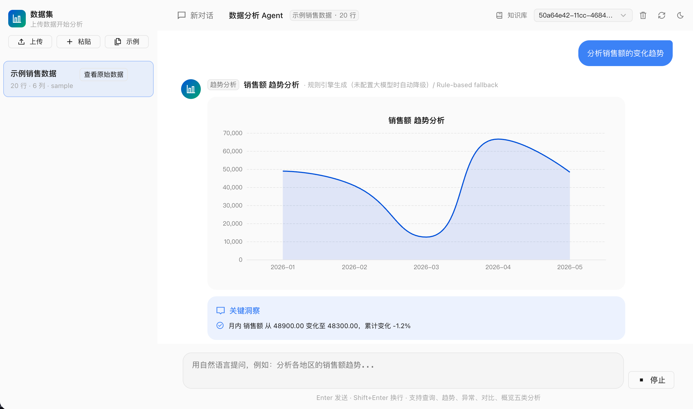
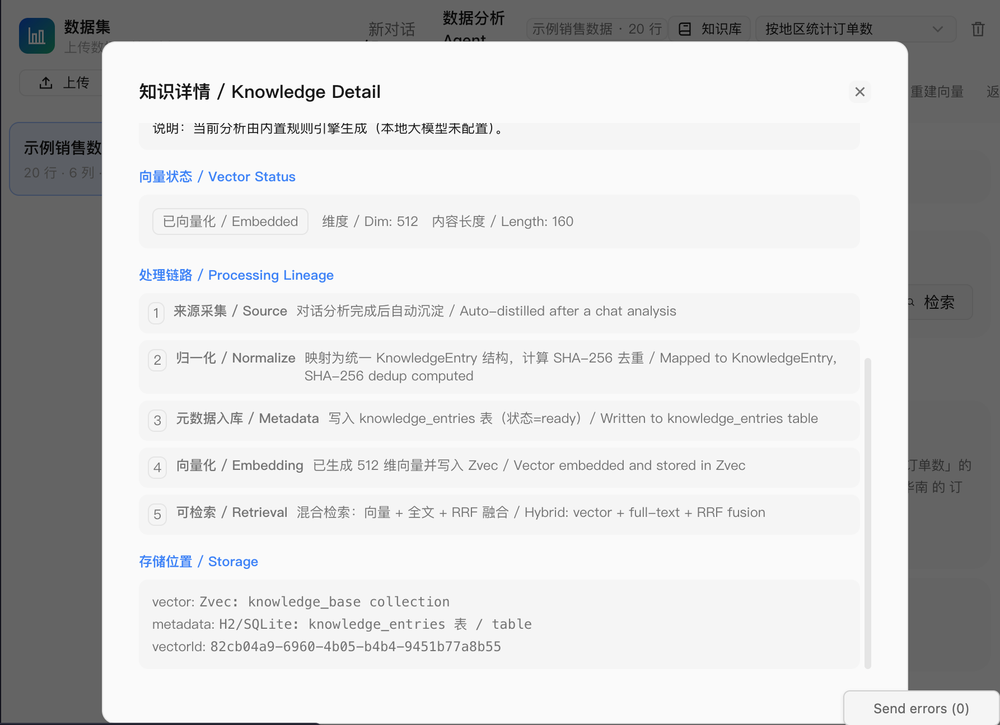

<div align="center">

# Axiom

**确定性分析内核 / The Deterministic Analytics Engine**

> 自然语言是入口，不是裁判。  
> 模型理解意图，引擎给出事实。  
> *Natural language in. Facts out.*

[](https://www.java.com)
[](https://spring.io)
[](https://react.dev)
[](https://duckdb.org)
[](docs/PROJECT_QA.md)

</div>

---

Axiom 是一个全栈 AI 数据分析系统。上传数据，用自然语言提问，它自动完成**数据查询、趋势分析、异常识别、指标对比**，并输出**可复现的结论与可视化图表**。

它的边界很清晰：**语言模型负责理解，确定性引擎负责计算**。

## 目录 / Contents

- [为什么是 Axiom](#为什么是-axiom--why-axiom)
- [设计公理](#设计公理--design-axioms)
- [能力矩阵](#能力矩阵--capabilities)
- [技术基座](#技术基座--foundation)
- [系统架构](#系统架构--architecture)
- [快速开始](#快速开始--quick-start)
- [API 概览](#api-概览--api-reference)
- [配置切换](#配置切换--configuration)
- [文档](#文档--documentation)
- [项目结构](#项目结构--repository-layout)

---

## 为什么是 Axiom / Why Axiom

分析系统的老问题： BI 工具够准但不够灵活，LLM 问答够灵活却不可信。Axiom 把两者拆开——**意图交给模型，数字交给引擎**。

| 维度 | 传统 BI | 纯 LLM 问答 | **Axiom** |
|---|---|---|---|
| 交互入口 | 拖拽 / 写 SQL | 自然语言 | 自然语言 |
| 数值来源 | 确定性查询 | 模型生成，可能幻觉 | **DuckDB SQL 确定性计算** |
| 结果可复现 | 是 | 否 | **是，可审计** |
| 业务语义 | 需人工建模 | 容易丢失口径 | **知识库 + 图谱注入** |
| 无网络可用 | 是 | 否 | **是，规则引擎降级** |
| 部署形态 | 重型服务 | 依赖外部 API | **单个可执行 jar** |

---

## 设计公理 / Design Axioms

| # | 公理 | 含义 |
|:--:|---|---|
| 1 | **数字不由模型生成** | LLM 只做「自然语言 → 分析计划」与「结果 → 结论」的语义转换；所有数值由 DuckDB SQL 计算 |
| 2 | **同一问题，同一答案** | 计算过程可复现、可审计，拒绝幻觉数字 |
| 3 | **离线依然可用** | 未配置 API Key 时自动降级到内置规则引擎，核心分析能力不中断 |
| 4 | **一切皆可插拔** | LLM、Embedding、元数据库、向量库均可配置切换 |

---

## 能力矩阵 / Capabilities

| 能力 | 说明 |
|---|---|
| 自然语言分析 | 上传 CSV / JSON / Excel 或粘贴文本，提问即得结论与图表 |
| 确定性计算 | 分析计划驱动 DuckDB SQL，模型全程不碰数字 |
| 趋势与异常 | 自动完成同比、环比、趋势拟合与异常点识别 |
| 知识底座 | 指标口径、术语、分析模板统一建模；向量 + FTS + RRF 混合检索 |
| 图谱推理 | 知识图谱 BFS 推理，版本快照、紧凑图、大图采样与结果缓存 |
| 流式交互 | SSE 实时推送分析计划、中间过程与最终结论 |
| 多模型热切换 | DeepSeek / 通义千问，运行时切换无需重启 |
| 离线降级 | 零 API Key 也能跑，内置规则引擎兜底 |

---

## 技术基座 / Foundation

| 层 | 技术 | 选型意图 |
|---|---|---|
| 前端 | React 18 + TypeScript + Vite + TDesign React + ECharts | 组件化 + 类型安全，图表开箱即用 |
| 后端 | Java 17 + Spring Boot 3.3 | 稳定、可观测、单 jar 交付 |
| 分析内核 | DuckDB（嵌入式 OLAP） | 列式聚合，零服务依赖，结果确定 |
| 元数据库 | H2（默认）/ SQLite（可切换） | 嵌入式，随应用启停 |
| 向量库 | Zvec（嵌入式，双 collection） | 数据集语义与知识库隔离 |
| 大模型 | DeepSeek / 通义千问，OpenAI 兼容策略模式 | 可插拔，新增厂商约 5 行代码 |
| Embedding | 本地 ONNX（bge-small-zh-v1.5）/ 远程 API | 默认零外部依赖 |
| 知识底座 | 统一 `KnowledgeEntry` + 混合检索 | 详见 [docs/KNOWLEDGE_BASE.md](docs/KNOWLEDGE_BASE.md) |
| 部署 | 单可执行 jar，前端静态资源内嵌 | 一条命令，常驻服务 |

---

## 系统架构 / Architecture

```
                    ┌────────────────────────────────┐
                    │      用户提问 / Question        │
                    └───────────────┬────────────────┘
                                    │ HTTP / SSE
                                    ▼
┌───────────────────────────────────────────────────────────────────────┐
│  React 前端 · 数据集 / 对话 / 知识库 / 图谱 / 运行时配置                │
└───────────────────────────────┬───────────────────────────────────────┘
                                ▼
┌───────────────────────────────────────────────────────────────────────┐
│  Spring Boot 编排层                                                    │
│   ┌──────────────────┐ ┌────────────────────┐ ┌──────────────────┐   │
│   │  LlmProvider     │ │  AnalysisEngine    │ │  VectorService   │   │
│   │  意图 → 计划      │ │  DuckDB SQL 计算   │ │  Zvec 语义检索    │   │
│   └────────┬─────────┘ └─────────┬──────────┘ └────────┬─────────┘   │
│            └─── 分析计划 JSON ───┘                     │             │
│                         │            语义检索 ◄─────────┘             │
│                         ▼                                            │
│                   结论生成 / 图表渲染                                  │
└───────────────────────────────┬───────────────────────────────────────┘
                                ▼
              H2 / SQLite 元数据 · DuckDB 分析库 · Zvec 向量
```

大模型只负责语义转换，数值计算由确定性引擎执行——这是「不编造数字」得以成立的前提。

---

## 快速开始 / Quick Start

### 30 秒启动 / Docker

```bash
cd axiom
cp .env.example .env        # 可选：填入 DEEPSEEK_API_KEY 或 QWEN_API_KEY

./scripts/docker-deploy.sh deploy   # 编译 + 打包 + 构建 + 启动 + 健康检查
# 公网 HTTPS：配置 DOMAIN 后执行 ./scripts/docker-deploy.sh prod
```

无需本地安装 JDK / Maven / Node，全部在镜像内完成。详见 [docs/DOCKER_DEPLOYMENT.md](docs/DOCKER_DEPLOYMENT.md)。

### 本地构建 / Local Build

**1. 配置（可选）**

配置位于 `backend/src/main/resources/application.yml`，可通过环境变量覆盖，所有厂商共享 `app.llm.providers.<name>.*` 结构：

```bash
export LLM_PROVIDER=deepseek          # 或 qwen
export DEEPSEEK_API_KEY=sk-你的密钥    # LLM_PROVIDER=deepseek 时
# export QWEN_API_KEY=sk-你的密钥       # LLM_PROVIDER=qwen 时（百炼兼容模式）
export EMBEDDING_API_KEY=你的嵌入密钥  # 可选，仅 embedding.provider=api 时
```

零密钥也能运行（规则引擎降级）；运行时可在前端「配置」面板热切换厂商与模型。

> 新增 LLM 厂商或换模型？见 [LLM 厂商与模型扩展指南](docs/LLM_PROVIDER_GUIDE.md)：换模型零代码，新增 OpenAI 兼容厂商约 5 行代码。

**2. 构建**

```bash
cd frontend && npm install && npm run build
cd .. && rm -rf backend/src/main/resources/static/assets
cp -r frontend/dist/* backend/src/main/resources/static/
cd backend && mvn clean package -DskipTests
```

**3. 运行**

```bash
# 常驻脚本（自动切到 backend）
./scripts/local-deploy.sh start     # 启动
./scripts/local-deploy.sh status    # 状态
./scripts/local-deploy.sh restart   # 重启
./scripts/local-deploy.sh stop      # 停止

# 或前台运行
cd backend && java -jar target/axiom-1.0.0.jar
```

访问 **http://localhost:8080**

<p align="center">
  <a href="docs/example.png"></a>
  <a href="docs/example2.png"></a>
</p>

### 测试与覆盖率 / Tests & Coverage

```bash
cd backend && mvn test                     # 后端 64 个测试
cd frontend && npm test                    # 前端 13 个测试（SSE 解析）
cd frontend && npm run test:coverage       # 前端覆盖率（Node 内建）
```

覆盖率：后端行覆盖 **31.9%**（分支 27.5%）、前端 `sse.ts` **100%**。报告见 `backend/target/site/jacoco/index.html`。后端未覆盖部分主要是依赖真实数据库 / ONNX 模型 / Zvec native 的集成型代码。

---

## API 概览 / API Reference

| 方法 | 路径 | 说明 |
|---|---|---|
| `GET` | `/api/health` | 健康检查 |
| `GET` | `/api/datasets` | 数据集列表 |
| `POST` | `/api/datasets/upload` | 上传 CSV / JSON / Excel |
| `POST` | `/api/datasets/paste` | 粘贴文本导入 |
| `POST` | `/api/datasets/sample` | 创建示例数据集 |
| `GET` | `/api/datasets/{id}/preview` | 数据预览 |
| `DELETE` | `/api/datasets/{id}` | 删除数据集 |
| `POST` | `/api/chat` | SSE 流式分析对话 |
| `GET` `DELETE` | `/api/sessions` | 会话管理 |
| `POST` | `/api/knowledge/entry` | 录入知识（指标 / 术语 / 模板） |
| `GET` | `/api/knowledge` | 知识列表与统计 |
| `POST` | `/api/knowledge/search` | 知识混合检索测试 |
| `DELETE` | `/api/knowledge/{id}` | 删除知识条目 |

---

## 配置切换 / Configuration

| 项 | 方式 | 默认值 |
|---|---|---|
| LLM 厂商 / 模型 | `LLM_PROVIDER`，详见 [扩展指南](docs/LLM_PROVIDER_GUIDE.md) | `deepseek` |
| Embedding | `EMBEDDING_PROVIDER=local\|api`，详见 [本地部署](docs/LOCAL_DEPLOYMENT.md) | `local` |
| 元数据库 | `METADATA_TYPE=h2\|sqlite` | `h2` |
| 向量库 | `ZVEC_ENABLED=false` 关闭 | `true` |
| 数据目录 | `DATA_DIR` | `./data` |
| Rerank 策略 | `RERANK_PROVIDER=auto\|llm\|rule` | `auto` |

---

## 文档 / Documentation

**核心设计**

| 文档 | 内容 |
|---|---|
| [知识库设计](docs/KNOWLEDGE_BASE.md) | 存储、检索、双写一致性、Rerank、知识图谱 |
| [知识图谱实现](docs/KNOWLEDGE_GRAPH.md) | 数据模型、构建流程、BFS 查询、已知限制与 GraphRAG 演进 |
| [图谱推理性能设计](docs/GRAPH_REASONING_PERFORMANCE.md) | 版本快照、紧凑图、大图采样、结果缓存 |
| [分析领域 DDD 模型](docs/DDD_ANALYSIS_MODEL.md) | 枚举值对象与 period 缺陷修复 |
| [项目问答](docs/PROJECT_QA.md) | 13 个关键设计问题 |
| [产品路线图](docs/ROADMAP.md) | 已完成功能、Backlog 与方向决策 |

**部署与扩展**

| 文档 | 内容 |
|---|---|
| [Docker 一键部署](docs/DOCKER_DEPLOYMENT.md) | 编译、打包、启动、公网 HTTPS、镜像推送 |
| [本地部署](docs/LOCAL_DEPLOYMENT.md) | bge-small-zh-v1.5 ONNX 模型下载与配置 |
| [LLM 厂商与模型扩展](docs/LLM_PROVIDER_GUIDE.md) | 新增厂商 / 换模型的配置与实现步骤 |

---

## 项目结构 / Repository Layout

```
axiom/
├── Dockerfile                 # 多阶段构建（前端 + 后端 + 模型）
├── docker-compose.yml         # 基础服务编排
├── docker-compose.prod.yml    # 公网 HTTPS overlay
├── scripts/
│   ├── docker-deploy.sh       # Docker 一键部署
│   ├── local-deploy.sh        # 本地 jar 常驻部署
│   └── backup.sh              # 数据备份与恢复
├── nginx/                     # 反向代理与证书
├── .env.example               # 环境变量模板
├── frontend/
│   └── src/
│       ├── App.tsx            # 主应用与 SSE 交互
│       ├── api.ts             # API 客户端
│       ├── sse.ts             # SSE 块解析（纯函数，可单测）
│       ├── components/
│       │   ├── DatasetPanel.tsx       # 数据集管理
│       │   ├── DatasourcePanel.tsx    # JDBC 数据源
│       │   ├── AnalysisMessage.tsx    # 分析结果渲染
│       │   ├── AnalysisChart.tsx      # ECharts 图表
│       │   ├── KnowledgePanel.tsx     # 知识库五视图
│       │   ├── GraphReasoningView.tsx # 图谱推理
│       │   └── LlmConfigPanel.tsx     # 运行时模型配置
│       ├── __tests__/         # 前端单元测试
│       └── types.ts
└── backend/
    └── src/main/java/com/axiom/
        ├── config/            # 数据源、Zvec、Web 配置
        ├── controller/        # REST + SSE API
        ├── service/           # 分析引擎、编排、向量、规则降级
        ├── repository/        # DuckDB / H2 双库访问
        ├── llm/               # 策略接口 + OpenAI 兼容基类 + 厂商实现 + 动态工厂
        └── model/             # 领域模型
```

---

<div align="center">

**Axiom** — 让每个数字都有据可依。  
*Every number, accounted for.*

</div>
